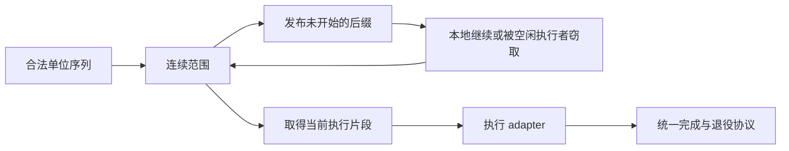

# JobSystem：合法最小单位与动态连续范围

状态：搁置的设计提案，不作为当前实施计划。隔离原子范围候选未通过性能门槛，生产实现保留现有动态认领与工作窃取。本提案适用现有 Native JobSystem；C# Job 接口、游戏算法与物理 ECS chunk 布局保持既有契约。

## 目标与边界

用一套范围获取、执行和退役机制承载数组与 ECS 工作。轻工作能够成批执行，空闲执行者能够取得尚未开始的工作，尾部能够缩小到接口允许的单位。粒度依据接口约束、可用执行者、剩余工作和已有成本信息决定。

该设计不承诺一个固定大小适合全部负载，也不承诺每项测试都快于 Unity。IJobChunk 的一次 Execute 已经开始后，调度器不能拆开其中的用户代码。

本机 Unity 6000.3.2f1 的 Entities 包以 `ScheduleParallelFor(totalChunkCount, 1)` 提交 IJobChunk，执行器通过 `GetWorkStealingRange` 获取连续范围。原生运行时的具体划分算法未在本轮核实；本设计采用上述公开边界，不假定复制其内部实现。

## 工作单位与范围

区分三个概念：合法工作单位、调度范围、当前执行片段。调度范围只包含连续的合法单位；执行片段可以包含一个或多个单位。

| 接口 | 第一阶段采用的合法单位 | 执行约束 |
|---|---|---|
| IJob | 一次 Execute | 整体执行，不拆分 |
| IJobParallelFor | 一个 index | 正常完成时每个 index 恰好执行一次；批次参数继续约束范围选择 |
| IJobParallelForBatch | 按现有契约划定的一批 | 保留用户可见的 start/count 和尾批边界 |
| IJobChunk | 一个物理 chunk 描述符 | 一次 Execute 不跨执行者拆分；保留 enabled mask、过滤和组件绑定 |
| IJobEntity | 现有 EntityBatchData 描述符 | 当前 adapter 的 start/count 指向描述符；第一阶段不猜测实体行偏移、不改描述符 ABI |

范围表示为半开区间 `[firstUnit, endUnit)`。不为每个实体或数组 index 分配任务对象，范围直接引用已有只读描述符或索引空间。查询布局使用现有结构版本标识，布局发生变化前仍须等待相关任务。

ECS 的实体数可作为工作量估计，不能据此断定各单位耗时相等。范围保留物理 chunk 边界，不把多个 chunk 永久封装成不可再次分配的大工作单位。

## 统一执行机制

复用现有 Injector、per-worker deque、任务池、完成状态和上下文池。由已有执行入口取得范围，再调用对应 adapter；调用线程协助执行也经过同一入口。

采用工作优先的范围分裂：执行者持有范围所有权，在合法边界选取执行前缀，将未开始的后缀发布到现有队列。后缀可由其他执行者窃取，也可由本执行者继续处理。已开始的前缀保持独占，分裂和重试不得重新执行它。

执行片段大小与合法最小单位分别保存。初始选择复用现有 API 参数和成本缓存；没有可靠成本信息时采用有界的保守划分。剩余工作减少或出现空闲执行者时缩小片段。具体退让阈值需通过有限代表性用例确定，不新增按 Job 名称选择的策略。

第一阶段保留连续访问顺序，不引入新的空间重排、优先级系统、取消系统或独立成本学习器。Run 继续顺序调用相同 adapter，不发布并行任务。

## 必须保持的安全不变量

1. **范围精确覆盖**：分裂后的前缀与后缀互不重叠，并集等于父范围；正常完成时合法单位无遗漏、无重复。
2. **单一所有者**：描述符处于发布中、队列中、执行中或已退役状态中的一种。队列所有权转移成功后，原持有者不得继续执行该描述符。
3. **先记账后发布**：父描述符持有任务生命周期引用；子描述符发布前增加在飞记账。失败路径必须保留原始工作并平衡记账，不能丢弃后缀或重复执行前缀。
4. **逻辑完成与物理退役分开**：所有工作结束后执行用户上下文 cleanup；完成态按既有协议发布。所有在飞描述符退出后，才回收元数据和底层存储。依赖回调不能观察到尚未完成的用户数据访问。
5. **代次与引用各负其责**：代次校验隔离槽位复用；访问元数据前还须持有有效生命周期引用。不能用“读一次 generation”代替持有引用。
6. **地址稳定**：已入队描述符不能来自随后会 resize 的 vector。动态分裂复用固定地址的 RangeTaskPool；池耗尽时走既有安全回退，不丢工作。
7. **队列容量有界**：当前 SparseTileDeque::PushBottom 没有容量拒绝接口。增加范围发布前，必须提供受检的发布结果；满队列时保留本地工作并有界处理，不能覆盖未消费槽位。
8. **算术安全**：长度、端点、分裂点、批次映射和内存大小使用受检计算；空范围不发布。分裂点落在合法边界且严格位于父范围内部。
9. **异常与上下文**：沿用已有异常记录和传播协议；失败不能重放已开始片段或使完成计数悬挂。保留 World、批次 ID 和执行者身份，嵌套执行恢复外层上下文。
10. **关闭与唤醒**：关闭阶段拒绝新增外部提交并排空已发布工作；Job 内关闭受到保护。发布到本地 deque 的后缀也必须纳入现有唤醒协议，不能只检查 Injector 是否有工作。

不在 Job 内同步等待自身、祖先或后继，依赖图继续要求无环。本设计不增加通用依赖环检测器。

## 与当前实现的衔接

| 当前部件 | 设计中的职责 |
|---|---|
| ExecutionTile、TileTask、RangeTask | 收敛为合法单位上的连续范围；保留任务身份与代次 |
| BatchState、HandleState | 保留依赖、异常、逻辑完成与物理退役的共同协议 |
| SparseTileDeque、Injector | 继续承担拥有者队列与跨线程提交；补齐分裂任务的受检发布和唤醒 |
| RangeTaskPool、上下文池 | 提供稳定地址和复用容量，稳态原生路径不引入托管对象 |
| EntityBatchData、ChunkJobData | 保持现有 ABI 和组件访问约定 |
| JobCostCache | 辅助选择执行片段，不作为精确耗时或均匀负载的证明 |
| 当前 ECS 单 tile 认领 | 作为当前已验证基线；迁移后不保留第二套 ECS 执行机制 |

当前 claim span、claim cap、guided 和切片策略需要在迁移时逐项归并。公开 API 以及已文档化的显式覆盖参数须列出兼容映射；不能悄悄改变参数含义，也不增加一组新的长期调优开关。

已有 E1 使用初始化线程识别 main，不能作为自动策略输入。使用执行入口传入的 worker/assist 角色核对统计口径，再使用尾部时间数据。

## 实施顺序与验收

### 1. 固定契约与范围操作

先独立验证范围分割、批次边界映射、空区间、INT_MAX 边界和代次复用；核对队列满、分裂失败与记账回滚。此阶段不改变游戏调度路径。

### 2. 迁移 ECS 范围执行

用物理 chunk／现有 EntityBatchData 描述符序列替代预先封死的大 tile，复用现有队列与完成协议。检查单任务、并发 Complete、协助执行、结构变更屏障、关闭和池复用。只做一组约定的 2-worker 短 Melee 对照，结果不足时报告不确定性，不持续追加轮数。

### 3. 接入数组与显式 Batch

逐索引 adapter 继续支持连续索引循环，显式 Batch 保持原边界。优先复用同一范围执行器，移除重复认领逻辑。仅检查对应的便宜／较重工作、均匀／偏斜分布，以及已有 1000 小 Job、1000 多批次压力项。

### 4. 收敛与发布检查

归并参数与重复机制，确认正常预热路径零托管分配。对受影响的范围、队列、依赖、回收、溢出和关闭用例做一次集中验证，并运行可用的内存检查器。性能验收同时关注固定成本、尾部延迟和缓存局部性，不能以单个游戏场景胜出代替通用验收。

每阶段均以真实运行结果决定是否保留改动。若低成本 Job 的固定开销或关键负载出现稳定回归，应缩小改动或停止迁移，不以更多特例补偿。

## 设计开始前的验证依据

当前实现的相关安全验证记录位于 `artifacts/jobsystem-safety-20261101/report.md`：25 个定向原生用例及对应 ASan 构建通过，唤醒存活检查通过，13 项 C# 原生桥接压力通过，7 种预热正常路径当前线程与进程总托管分配均为 0 B。

该证据覆盖当前实现，不代表本提案已经通过验证。Windows 本轮没有运行 ThreadSanitizer；ASan 也不能证明不存在数据竞争。新范围机制的安全验证须在实现后重新执行受影响用例。
